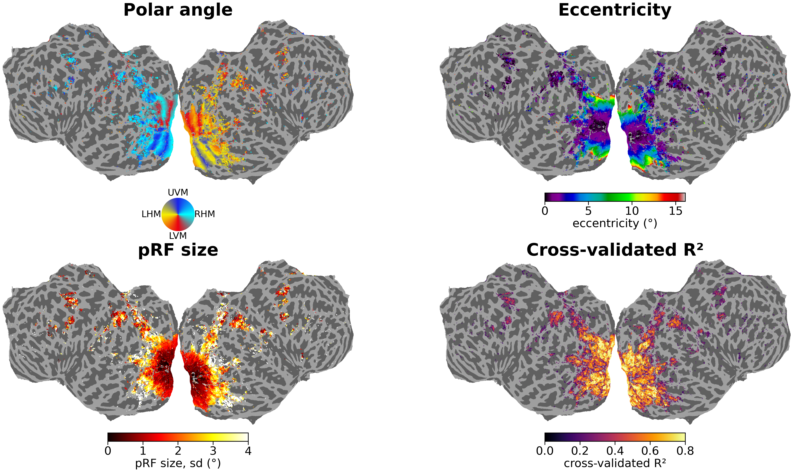

===========
Retinotopy
===========

.. |R2CV_CUT| replace:: 0.15

Population receptive field (pRF) estimates (Dumoulin & Wandell, 2008) are
released as parameter maps on the ``fsnative`` surface and in the
participant's ``T1w`` volume, for the LAION subjects. They are the basis for the
retinotopic :doc:`rois`.

.. admonition:: TL;DR — best maps
   :class: tip

   For reliable retinotopic maps, we recommend the filtered ``paradigm-best``
   maps in ``derivatives/retinotopy/sub-XX/func/``, on the surface and in the
   volume:

   .. code-block:: text

      sub-XX_paradigm-best_hemi-L_space-fsnative_param-angle_model-dnhrf_desc-filtered_statmap.func.gii
      sub-XX_paradigm-best_space-T1w_res-1pt8_param-angle_model-dnhrf_desc-filtered_statmap.nii.gz

   They keep only pRFs with ``r2cv`` ≥ |R2CV_CUT| and a centre inside the
   stimulated field of the paradigm that fitted it. The unfiltered maps,
   without ``desc-filtered``, hold every fitted vertex or voxel. In Python,
   ``sub.get_prf("angle", desc="filtered", roi=["V1d", "V1v"])`` returns them indexed
   like the betas (`Downloading and loading`_). See
   :ref:`retinotopy-best-maps` and :ref:`retinotopy-quality` for details.

   Filtered ``paradigm-best`` ``dnhrf`` maps for sub-03 on the flattened
   cortex. Only pRFs with ``r2cv`` ≥ |R2CV_CUT| and a centre inside the
   stimulated field are shown.

Data Splits
===========

The retinotopy experiment consisted of three paradigms, each covering a
different range of eccentricities (see :doc:`experimental_design` for the
stimuli). Within a paradigm, the BIDS ``task-`` entity distinguishes runs
that differ in bar width, aperture shape or fixation position. Each task included in the fitting
was run four times per participant.
The ``task-4bar`` was only run twice and is excluded from the fitting to preserve the four-repeat structure.

.. list-table::
   :widths: 14 42 32 12
   :header-rows: 1

   * - Paradigm
     - Tasks
     - Sessions
     - Runs
   * - ``standard``
     - ``task-BARL``, ``task-BARM``, ``task-BARS``
     - ``ses-MotionLocBarsSML``, ``ses-BarsLMSEyeCalib``
     - 12
   * - ``corners``
     - ``task-UpperLeft``, ``task-UpperRight``, ``task-LowerLeft``,
       ``task-LowerRight``
     - ``ses-Corners1``, ``ses-Corners2``
     - 16
   * - ``foveal``
     - ``task-BAR``, ``task-WEDGE``
     - ``ses-Foveal``
     - 8

For **sub-06**, ``ses-Corners2`` is excluded from every fit because of its
reduced response reliability. This participant's corners fits use the eight runs of
``ses-Corners1``.

Repeats of each task were averaged, the tasks within each paradigm were concatenated, and each of the three paradigms was fitted separately. 
The three fits were later combined into the :ref:`retinotopy-best-maps`.

.. _retinotopy-halves:

Full fit and split halves
-------------------------

The released maps are fitted to all runs, with nothing held out. Each
paradigm is additionally fitted twice on half of its runs, and the even-odd
splits are released as ``desc-odd`` and ``desc-even``.

The half fits refine exactly the vertices and voxels the full fit carried
past the R² filter (see `Model Pipeline`_), so all three share one set of
locations. Predicting each half's data from the other half's fit gives the
cross-validated quality measures described in :ref:`retinotopy-quality`.

The four corner tasks are fitted together as one paradigm. A single corner run
covers the same extent as a standard bar run, but the union over the
four tasks reaches further into the periphery.
Note that the ``task-`` label in the corner-fixation paradigm names the fixation position, not the stimulated quadrant. 
``task-LowerLeft`` places fixation in the lower left of the screen and therefore stimulates the upper right of the visual
field.

.. _retinotopy-apertures:

pRF Modeling
===================================

Apertures
---------

The stimulus is represented as apertures marking the stimulated region of the
visual field, one per stimulus frame. For the fit they are downsampled in both
space and time. Spatially, they are reduced ten-fold from the screen
dimensions to 192 × 108 pixels; one pixel subtends 0.09 dva, so the 2.5, 1.0
and 0.4 dva bars are 28, 11 and 4.5 px wide. Temporally, the frames are binned
from the 0.1 s time base of the stimulus presentation to the 1 s time base of
the upsampled functional timeseries (:doc:`preprocessing`), and each value is
the fraction of the 1 s bin for which the pixel was stimulated.

The apertures are gaze-centred. Each run's screen is placed on a
362 × 194 px canvas spanning 32.2 × 17.6 dva, so that the canvas holds the
union of the four corner fixations and every paradigm shares one coordinate
frame. Coordinates are linear in screen position, scaled so that the centre
and the canvas edges sit at their true visual angle. Because the display is a
flat screen, they depart from the exact visual angle by 0.0 to 0.2 dva. The
raster is bottom-up: row 0 is the lower edge of the field and y increases
with row index.

The aperture libraries, the per-run design matrices and the frame timing are
released; see :ref:`retinotopy-stimulus-files`.

Model Pipeline
--------------

Fitting is done with `braincoder <https://github.com/Gilles86/braincoder>`_ on
the percent-signal-change, DCT high-pass filtered timeseries, in each
participant's ``fsnative`` or ``T1w`` space.

The full model is a **divisive normalisation (DN)** pRF (Aqil et al., 2021):
an excitatory Gaussian receptive field whose response is divided by a
suppressive surround. It contains the simpler **Gaussian** pRF: DN keeps its
position and size (``x``, ``y``, ``sd``), renames its amplitude and baseline
(``rfamplitude``, ``boldbaseline``) and adds four surround parameters. With a
negligible surround it reduces to the Gaussian.

The fit proceeds in four stages, each a combination of response model, SPM
haemodynamic response function (HRF), and fitting method, and each starting from the one before. **All four
are released**, named by the ``model-`` entity. ``dnhrf`` is the full model and the one to
use unless a specific comparison needs an earlier stage.

.. list-table::
   :widths: 12 16 12 42 18
   :header-rows: 1

   * - ``model-``
     - pRF model
     - HRF
     - Method
     - Starts from
   * - ``ols``
     - Gaussian
     - fixed
     - Grid search for ``x``, ``y``, ``sd``, then least squares for
       ``amplitude``, ``baseline``
     - —
   * - ``gauss``
     - Gaussian
     - fixed
     - Gradient descent
     - ``ols``
   * - ``dn``
     - DN
     - fixed
     - Gradient descent
     - ``gauss``, where R² > 0.05
   * - ``dnhrf``
     - DN
     - fitted
     - Gradient descent
     - ``dn``

Each parameter is initialised once, when its component enters the fit:

+------------------+----------------------------+----------------------------------------+
| Component        | Parameter                  | Initialisation                         |
+==================+============================+========================================+
| Gaussian         | ``x``, ``y``               | Grid search, log-spaced from           |
| (both models)    |                            | the centre to the edge of the          |
|                  |                            | stimulated field. x × y values:        |
|                  |                            | 66 × 60 in ``standard``,               |
|                  |                            | 52 × 52 in ``foveal``,                 |
|                  |                            | 72 × 66 in ``corners``                 |
|                  +----------------------------+----------------------------------------+
|                  | ``sd``                     | Grid search, 40 values,                |
|                  |                            | 0.1 to 16 dva                          |
|                  +----------------------------+----------------------------------------+
|                  | ``amplitude``,             | Least squares on the grid              |
|                  | in DN ``rfamplitude``      | winner. DN starts from the             |
|                  |                            | ``gauss`` value                        |
|                  +----------------------------+----------------------------------------+
|                  | ``baseline``,              | Least squares on the grid              |
|                  | in DN ``boldbaseline``     | winner. DN starts from the             |
|                  |                            | ``gauss`` value                        |
+------------------+----------------------------+----------------------------------------+
| DN surround      | ``srfamplitude``           | 0.01                                   |
|                  +----------------------------+----------------------------------------+
|                  | ``srfsize``                | 6                                      |
|                  +----------------------------+----------------------------------------+
|                  | ``neuralbaseline``         | 1                                      |
|                  +----------------------------+----------------------------------------+
|                  | ``surroundbaseline``       | 1                                      |
+------------------+----------------------------+----------------------------------------+
| HRF              | ``hrfdelay``               | 4.5 s, bounded to [3, 7] s             |
| (both models)    |                            | when fitted                            |
|                  +----------------------------+----------------------------------------+
|                  | ``hrfdispersion``          | 0.75 s, bounded to [0.3, 2.0] s        |
|                  |                            | when fitted                            |
+------------------+----------------------------+----------------------------------------+

The surround starting values reduce the DN model to almost exactly the
``gauss`` fit: the surround starts weak and the two baselines cancel, so
suppression is introduced by the optimiser rather than by the initialisation.

The **R² filter** is applied between ``gauss`` and ``dn``: only vertices or
voxels with in-sample ``gauss`` R² greater than 0.05 are refined in ``dn``
and ``dnhrf``. Vertices/voxels that do not pass the filter keep their
parameters in the ``ols`` and ``gauss`` maps but are ``NaN`` in the ``dn``
and ``dnhrf`` maps. Locations without signal (outside the field of view, or
with zero variance) are ``NaN`` at every stage.

**Position and size are not bounded** after the grid search. A pRF centre
can therefore lie outside the stimulated field, which spans ±8.52 × ±4.88
dva in ``standard``, ±1.92 × ±1.96 dva in ``foveal`` and ±16.1 × ±8.8 dva
over the four ``corners`` tasks.

.. _retinotopy-quality:

Evaluation
==========

The released maps are fitted on all runs to get the most accurate parameter estimates. 
Because in-sample ``r2`` is not comparable across paradigms or stages, 
every fit is also scored by split-half cross-validation (:ref:`retinotopy-halves`). 
Three maps result:

.. list-table::
   :widths: 26 74
   :header-rows: 1

   * - Map
     - What it tells you
   * - ``nc`` with ``desc-half``
     - How repeatable the data themselves are, independent of any model:
       the best score a perfect model could reach on half the runs.
   * - ``r2cv`` with ``desc-half``
     - How well a fit on half the runs predicts the other half. Measured
       directly.
   * - ``r2cv``
     - The split-half score, extrapolated to the released fit on all runs.
       Use this one to judge or threshold the released maps.

All three are on the R² scale. The two ``r2cv`` maps are signed: a negative
value means the prediction anti-correlates with the held-out data.

How the scores are computed
---------------------------

**Noise ceiling** (``nc``, ``desc-half``). The correlation between the odd-run
and the even-run mean timeseries, i.e. the split-half reliability of the data.
A model that predicted the noise-free response exactly would reach ``nc`` on
the split-half score.

**Split-half score** (``r2cv``, ``desc-half``). The fit to the odd runs
predicts the mean of the even runs, and the fit to the even runs predicts the
mean of the odd runs. The two prediction–data correlations are averaged on the
Fisher-z scale and reported as the signed square ``r · |r|``, which is on the
R² scale but keeps the sign.

**Full-fit score** (``r2cv``). The released fit uses all runs, twice the data
of a half fit, and no independent data of that size exist to test it on. Its
score is therefore extrapolated from the halves. The split-half score factors
approximately as

.. code-block:: text

   r2cv_half ≈ m² · ρ_pred · ρ_data

where ``m²`` is the share of the noise-free response the model captures,
``ρ_data`` is the reliability of the data (``nc``), and ``ρ_pred`` is the
reliability of the fitted prediction, the correlation between the odd-fit and
even-fit predictions. Doubling the data leaves ``m²`` unchanged and raises
each reliability by the Spearman–Brown correction, ``ρ → 2ρ / (1 + ρ)``,
which gives

.. code-block:: text

   r2cv = r2cv_half · 4 / ((1 + ρ_pred) · (1 + nc))

For sub-06 corners, where each half is one run, the extrapolation describes
that participant's two-run fit.

Filtered maps
-------------

The ``desc-filtered`` files keep pRFs with ``r2cv`` ≥ |R2CV_CUT| whose centre
lies inside the stimulated field of the paradigm that fitted it
(`Model Pipeline`_), so they hold only pRFs whose position and size the data
constrain. Their sidecars record both criteria. The filters are a
recommendation, not part of the fit: the unfiltered maps are the full
product, for anyone who wants a different cut.

Released parameters
===================

Each parameter is a separate file, named by ``param-``.

.. list-table::
   :widths: 22 40 38
   :header-rows: 1

   * - ``param-``
     - Meaning
     - Units
   * - ``angle``
     - Polar angle of the pRF centre
     - degrees, ``[0, 360)``
   * - ``ecc``
     - Eccentricity of the pRF centre
     - degrees of visual angle
   * - ``x``
     - Horizontal position of the pRF centre, positive to the right
     - degrees of visual angle
   * - ``y``
     - Vertical position of the pRF centre, positive upward
     - degrees of visual angle
   * - ``sd``
     - Standard deviation of the Gaussian pRF
     - degrees of visual angle
   * - ``r2``
     - Variance explained **in-sample**, on the data the fit saw
     - unitless
   * - ``r2cv``
     - Cross-validated R² of the full fit, extrapolated from the split
       halves (:ref:`retinotopy-quality`)
     - unitless, signed
   * - ``r2cv`` with ``desc-half``
     - Cross-validated R² between the split halves, as measured
     - unitless, signed
   * - ``nc`` with ``desc-half``
     - Noise ceiling: correlation between the odd- and even-run means
     - unitless
   * - ``amplitude``
     - Response amplitude
     - percent signal change
   * - ``baseline``
     - Additive baseline of the predicted response
     - percent signal change
   * - ``boldbaseline``
     - BOLD baseline of the DN model
     - percent signal change
   * - ``neuralbaseline``
     - Neural baseline of the DN model
     - arbitrary
   * - ``surroundbaseline``
     - Surround baseline of the DN model
     - arbitrary
   * - ``rfamplitude``
     - Amplitude of the excitatory receptive field
     - arbitrary
   * - ``srfamplitude``
     - Amplitude of the suppressive receptive field, as a multiple of
       ``rfamplitude``
     - unitless
   * - ``srfsize``
     - Size of the suppressive receptive field, as a multiple of ``sd``
       (always > 1)
     - unitless
   * - ``hrfdelay``
     - HRF delay
     - seconds
   * - ``hrfdispersion``
     - HRF dispersion
     - seconds

``r2cv`` exists for every stage, ``nc`` once per paradigm (it describes the
data, not a fit). Both describe the full fit; the ``desc-odd`` and
``desc-even`` fits carry neither.

Coordinate convention
---------------------

Parameter maps use ``+x`` = right and ``+y`` = up, from the participant's point
of view. Polar **angle** increases counter-clockwise from the right horizontal
meridian on ``[0, 360)``, and **eccentricity** is in degrees of visual angle.

Every fit's centre is released in both forms: ``param-x`` and ``param-y``
are the fitted Cartesian centre, and ``param-ecc`` and ``param-angle`` are
computed from them (``ecc = sqrt(x² + y²)``, ``angle = atan2(y, x)`` in
degrees on ``[0, 360)``).

.. _retinotopy-best-maps:

Combined best maps
------------------

The ``paradigm-best`` maps combine the three paradigms into one set of pRF
estimates, on the surface and in the volume (both grids). At each vertex or
voxel, the ``model-dnhrf`` fit with the highest ``r2cv`` supplies the
parameters: the paradigm whose fit best predicts independent data. The
best-of is released for ``x``, ``y``, ``ecc``, ``angle``, ``sd``, ``r2`` and
``r2cv`` (plus ``r2cv`` with ``desc-half`` for the unfiltered maps), each the
selected fit's value.

Which paradigm was selected is stored in the ``seg-winner`` segmentation
files, one per hemisphere on the surface and one per volume grid. Their values
are 0 (no paradigm fitted), 1 (standard), 2 (foveal) and 3 (corners). The
surface files also carry the labels in the GIFTI label table, so surface
viewers show the paradigm names. In Python,
``sub.get_prf("winner")`` returns the names directly.

Spaces and grids
================

Surface and volumetric fits are available in the participant's own space.

.. list-table::
   :widths: 30 70
   :header-rows: 1

   * - Sampling
     - Notes
   * - ``space-fsnative``
     - Fits computed on the participant's FreeSurfer surface, with separate
       ``hemi-L`` and ``hemi-R`` maps.
   * - ``space-T1w res-1pt5``
     - Fits computed directly in volume space on the 1.5 mm isotropic
       functional grid.
   * - ``space-T1w res-1pt8``
     - The 1.5 mm parameter maps resampled onto the GLMsingle beta grid
       (1.778 mm isotropic), so maps and betas share voxels.

Each volumetric parameter is provided as one NIfTI file covering the fitted
cortical, subcortical and cerebellar regions. The ``res-1pt8`` maps use
**nearest-neighbor resampling**, with the same source voxel selected for
every parameter. This preserves each fit's parameter tuple rather than
averaging parameters across neighboring voxels.

.. _retinotopy-stimulus-files:

Released stimulus files
=======================

Three kinds of file describe the stimulus. Together they reproduce the
design matrices the maps were fitted on, and allow building variants.

**Aperture libraries** (``stimuli/retinotopy/``). The binary apertures as
presented, one file per stimulus and one dataset per sweep direction. They
are the original presentation files, renamed after the task that defines
them:

.. list-table::
   :widths: 24 22 30 24
   :header-rows: 1

   * - File
     - Stimulus
     - Datasets (frames × px)
     - Used by
   * - ``task-BARS_apertures.h5``
     - Bar, 0.4 dva wide
     - ``0x0235_0x1_{0,90,180,270}``
       (375 or 225 × 1080 × 1920)
     - ``task-BARS``
   * - ``task-BARM_apertures.h5``
     - Bar, 1.0 dva wide
     - ``0x05789_0x1_{0,90,180,270}``
       (375 or 225 × 1080 × 1920)
     - ``task-BARM``, ``task-4bar`` and the four corner-fixation tasks
   * - ``task-BARL_apertures.h5``
     - Bar, 2.5 dva wide
     - ``0x1438_0x1_{0,90,180,270}``
       (375 or 225 × 1080 × 1920)
     - ``task-BARL``
   * - ``task-BAR_apertures.h5``
     - Foveal bar, 0.4 dva wide
     - ``0x1_0x1_{0,90,180,270}``
       (225 × 440 × 440)
     - ``task-BAR``
   * - ``task-WEDGE_apertures.h5``
     - Foveal wedge, 30°
     - ``30x0_0x1_{1,2}``
       (1200 × 440 × 440)
     - ``task-WEDGE``

Every library shows one frame per 0.1 s. The last part of a dataset name is
the sweep direction, as in the frame tables' ``direction`` column below
(0, 90, 180, 270: bar moving rightward, upward, leftward, downward; 1, 2:
wedge rotating counter-clockwise, clockwise). Bar libraries cover the full
screen; the foveal ones are a 440 × 440 px inset at the screen centre.
Corner-fixation runs show the medium bars unchanged and move the fixation
point instead. Row 0 is the bottom of the screen. Each file's sidecar gives
the screen geometry.

**Design matrices** (``derivatives/preproc-mapping/sub-XX/ses-YY/func/
…_desc-apertures_design.h5``). One per run, exactly as fitted: the dataset
``design`` (volumes × 194 × 362, float32) on the gaze-centred canvas above,
with ``x`` and ``y`` holding the canvas coordinates in degrees from fixation.
Its length matches the run's preprocessed BOLD. The sidecar gives the
fixation position (``FixationPosition``, screen pixels from the screen
centre, y upward).

**Frame tables** (``…_desc-frames_design.tsv``, same folder). One row per
aperture frame, on the timeline of the run's preprocessed BOLD:

.. list-table::
   :widths: 22 78
   :header-rows: 1

   * - Column
     - Meaning
   * - ``onset``, ``duration``
     - When the frame was shown (s from the first volume) and its refresh
       time. For frames without a display timestamp this is the scheduled
       time.
   * - ``stim_file``, ``stim_key``, ``seq_index``
     - Which library frame was shown: file (relative to ``stimuli/``),
       dataset, frame index.
   * - ``direction``
     - Bars: direction of motion in degrees, counter-clockwise from
       rightward (0 left to right, 90 bottom to top, 180, 270). Wedge: 1
       counter-clockwise, 2 clockwise, both starting at 3 o'clock.
   * - ``status``
     - ``stamped`` (displayed at ``onset_recorded``), ``dropped`` (never
       displayed) or ``shown_unstamped`` (missing timestamp record,
       placed at ``onset_scheduled``).
   * - ``volume``
     - The design-matrix row (0-based) the frame was averaged into; n/a for
       frames the design does not use.
   * - ``trial``, ``onset_recorded``, ``onset_scheduled``
     - Sweep number, and the raw recorded and scheduled display times.

``volume`` is stated rather than left to be recomputed from ``onset``:
frames that fall exactly on a volume boundary were assigned by
floating-point rounding, so a recomputation can put them in the
neighbouring volume. To rebuild a design matrix at screen resolution:

.. code-block:: python

   import h5py
   import numpy as np
   import pandas as pd

   frames = pd.read_csv(frames_tsv, sep="\t", na_values="n/a")
   used = frames.dropna(subset=["volume"])
   with h5py.File(stimuli_dir / used["stim_file"].iloc[0], "r") as lib:
       first = lib[used["stim_key"].iloc[0]]
       dm = np.zeros((n_volumes,) + first.shape[1:])
       for v, rows in used.groupby("volume"):
           dm[int(v)] = np.mean([lib[k][int(i)] for k, i in
                                 zip(rows["stim_key"], rows["seq_index"])], axis=0)

``dm`` is screen-referenced. The released matrix samples it every tenth
pixel (offset 5) to 108 × 192, embedding the foveal inset as a 44 × 44 patch
at the centre, and places the result on the canvas shifted by
``-FixationPosition / 10`` pixels.

Six runs of ``sub-01`` (``ses-MotionLocBarsSML``) started 18 s late. Their
BOLD is released re-indexed onto the common timeline and also as acquired,
and the design files follow: the unmarked files are on the common timeline,
the ``desc-aperturesAsAcquired`` and ``desc-framesAsAcquired`` files match the
as-acquired BOLD.

Downloading and loading
=======================

The pRF maps are pulled as one tree, every paradigm and model stage, with
the ``include_retinotopy`` flag:

.. code-block:: python

   from laion_fmri.download import download

   download(subject="sub-03", include_retinotopy=True)

:func:`~laion_fmri.download.download_mapping` fetches the same maps
together with the localizer maps, the ROIs and the aperture libraries,
for every subject of the precision-mapping dataset
(:doc:`laion_fmri_package/download`).

Resolve one downloaded map without reconstructing its filename by hand, then
load it with nibabel:

.. code-block:: python

   import nibabel as nib
   from laion_fmri.derivatives import prf_map_path

   path = prf_map_path("sub-03", "angle")
   angle = nib.load(path).get_fdata()

   path_L = prf_map_path("sub-03", "angle", space="fsnative", hemi="L")
   angle_L = nib.load(path_L).agg_data()

For consistency with the main experiment accessors, the default is the 
``paradigm-best``, ``model-dnhrf`` volume on the
GLMsingle beta grid (``space="T1w"``, ``res="1pt8"``). ``res="1pt5"`` is
the grid the fit was computed on. For a surface map pass
``space="fsnative"`` and ``hemi``.

``desc=`` selects a variant (`File organization`_), e.g. the filtered map
or the measured split-half quality.

.. code-block:: python

   filtered = prf_map_path("sub-03", "angle", desc="filtered")
   r2cv_half = prf_map_path("sub-03", "r2cv", desc="half")
   nc = prf_map_path("sub-03", "nc", paradigm="standard", desc="half")

To load values rather than paths, ``Subject.get_prf`` reads a map and
indexes it like the other subject accessors. In the volume it reads the
``res-1pt8`` map and returns one value per brain-mask voxel, in the same
order as the voxel axis of ``get_betas``; ``roi=`` or ``mask=`` select
within it. On the surface (``space="fsnative"``, ``hemi`` required) it
returns one value per vertex, or per vertex of ``roi``:

.. code-block:: python

   from laion_fmri import load_subject

   sub = load_subject("sub-03")
   v1 = ["V1d", "V1v"]
   angle = sub.get_prf("angle", roi=v1)                 # best-of, dnhrf
   winner = sub.get_prf("winner", roi=v1)               # "standard", "foveal", "corners", "none"
   betas = sub.get_betas(session="ses-01", roi=v1)      # same voxels as angle
   ecc = sub.get_prf("ecc", paradigm="foveal", desc="filtered", space="fsnative", hemi="L")

Parameter values are ``float32`` with ``NaN`` where the fit has no value;
``"winner"`` returns paradigm names and exists for ``paradigm="best"`` only.

File organization
=================

pRF fits sit flat under ``sub-XX/func/`` rather than under a session: a
paradigm pools runs across sessions, so its maps have no single session to
name. ``paradigm-`` carries the paradigm, ``model-`` the fit stage. A file
without ``desc-`` belongs to the full fit, and ``desc-`` marks a variant of it:

.. list-table::
   :widths: 22 78
   :header-rows: 1

   * - ``desc-``
     - Variant
   * - ``odd``, ``even``
     - The split-half fits (:ref:`retinotopy-halves`), every stage and
       parameter.
   * - ``half``
     - The measured split-half quality maps, ``r2cv`` and ``nc``
       (:ref:`retinotopy-quality`).
   * - ``filtered``
     - The full fit's ``dnhrf`` maps, set to ``NaN`` where ``r2cv`` is below
       |R2CV_CUT| or the centre lies outside the stimulated field.
       For ``paradigm-best``, the winner is chosen again among the fits
       that pass both criteria, rather than masking the unfiltered best-of.
       The sidecar's ``Filter`` field records both.

.. code-block:: text

    derivatives/retinotopy/
    ├── seg-winner_dseg.tsv
    └── sub-XX/
        └── func/
            ├── sub-XX_paradigm-standard_hemi-L_space-fsnative_param-angle_model-dnhrf_statmap.func.gii
            ├── sub-XX_paradigm-standard_hemi-L_space-fsnative_param-angle_model-dnhrf_desc-filtered_statmap.func.gii
            ├── sub-XX_paradigm-standard_hemi-L_space-fsnative_param-angle_model-dnhrf_desc-odd_statmap.func.gii
            ├── sub-XX_paradigm-standard_hemi-L_space-fsnative_param-r2cv_model-dnhrf_statmap.func.gii
            ├── sub-XX_paradigm-standard_hemi-L_space-fsnative_param-r2cv_model-dnhrf_desc-half_statmap.func.gii
            ├── sub-XX_paradigm-standard_hemi-L_space-fsnative_param-nc_desc-half_statmap.func.gii
            ├── sub-XX_paradigm-standard_space-T1w_res-1pt5_param-angle_model-dnhrf_statmap.nii.gz
            ├── sub-XX_paradigm-standard_space-T1w_res-1pt8_param-angle_model-dnhrf_statmap.nii.gz
            ├── sub-XX_paradigm-best_hemi-L_space-fsnative_param-angle_model-dnhrf_statmap.func.gii
            ├── sub-XX_paradigm-best_space-T1w_res-1pt8_param-angle_model-dnhrf_desc-filtered_statmap.nii.gz
            ├── sub-XX_paradigm-best_hemi-L_space-fsnative_model-dnhrf_seg-winner_dseg.label.gii
            └── sub-XX_paradigm-best_space-T1w_res-1pt8_model-dnhrf_seg-winner_dseg.nii.gz

References
==========

- Aqil M, Knapen T and Dumoulin SO (2021) Divisive normalization unifies
  disparate response signatures throughout the human visual hierarchy.
  *PNAS* 118:e2108713118.
  `doi:10.1073/pnas.2108713118 <https://doi.org/10.1073/pnas.2108713118>`_
- Dumoulin SO and Wandell BA (2008) Population receptive field estimates in
  human visual cortex. *NeuroImage* 39:647-660.
  `doi:10.1016/j.neuroimage.2007.09.034
  <https://doi.org/10.1016/j.neuroimage.2007.09.034>`_
