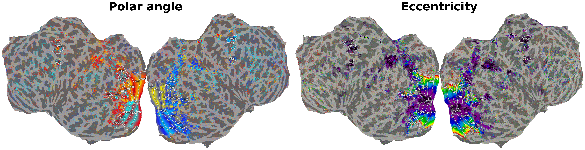
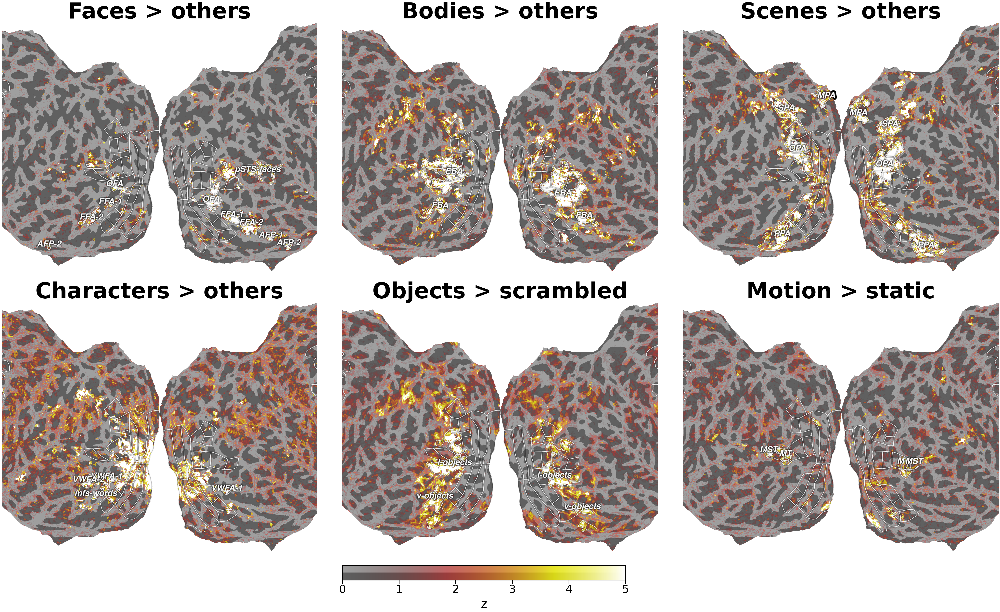
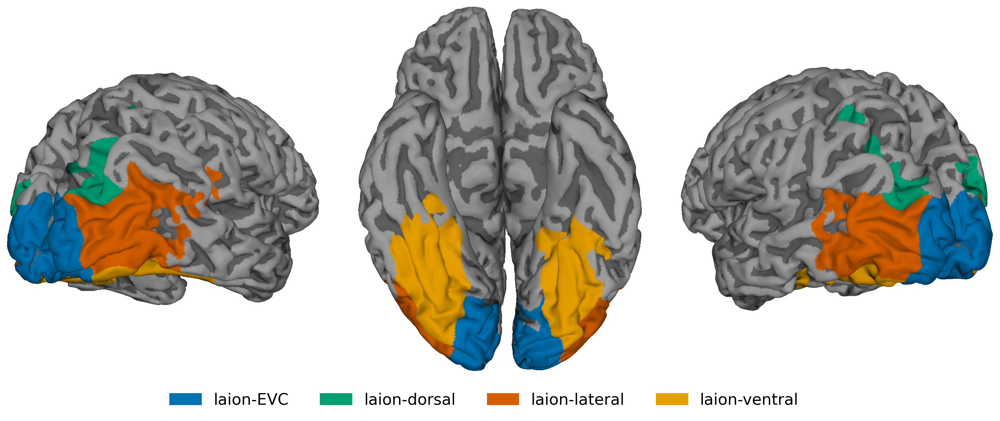

====
ROIs
====

ROI masks are provided for all subjects and cover retinotopically defined
visual areas, category-selective regions from functional localizers,
motion-selective areas, and visual-stream parcels. The ROIs are
provided as a suggested common reference for downstream analyses. The
underlying localizer contrasts (:doc:`localizers`) and pRF parameter maps
(:doc:`retinotopy`) are released alongside them, so alternative definitions can
be derived from the same data.

Available ROI Sets
==================

.. list-table::
   :widths: 22 35 20 23
   :header-rows: 1

   * - Set
     - ROIs
     - Source
     - Criterion
   * - **Retinotopic**
     - V1v, V1d, V2v, V2d, V3v, V3d, V3A, V3B, hV4, LO1, LO2,
       TO1, TO2, VO1, VO2, IPS0, SPCS, IPCS, EVC
     - Retinotopy localizer
     - Polar angle reversals, eccentricity gradients (R²-thresholded)
   * - **Retinotopic (LAION-stimulated)**
     - laionstim- versions of the retinotopic ROIs above
     - Filter of the retinotopic ROIs
     - pRF centre inside the LAION image
   * - **Face-selective**
     - OFA, FFA-1, FFA-2, pSTS-faces, AFP-1, AFP-2
     - fLoc
     - faces > others
   * - **Body-selective**
     - EBA, FBA
     - fLoc
     - bodies > others
   * - **Scene-selective**
     - PPA, OPA, MPA, SPA
     - fLoc
     - scenes > others
   * - **Character-selective**
     - VWFA-1, VWFA-2, mfs-words, pSTS-words
     - fLoc
     - characters > others
   * - **Object-selective**
     - l-objects, v-objects
     - Object localizer
     - objects > scrambled
   * - **Motion**
     - MT, MST
     - Motion localizer
     - motion > static, ipsilateral > static
   * - **General visual selectivity**
     - laion-general
     - LAION main experiment
     - GLMsingle R²
   * - **Sectors of visual selectivity**
     - laion-EVC, laion-dorsal, laion-lateral, laion-ventral
     - Retinotopic ROIs + anatomical borders
     - Subdivision of laion-general

Functional ROIs
===============

Design Choices
---------------

All functional ROIs were manually delineated on the cortical surface.
Statistical maps informing the delineations, such as polar angle, or
localizer contrast t-statistics, were rendered as flatmaps via pycortex
(Gao et al., 2015) and annotated in Inkscape.

**Selection of ROIs.**
ROIs were included based on relevance to the field and consistent
identifiability across subjects.

**Mutual exclusivity.**
ROIs can overlap across sets but not within a set. For example, face-selective
FFA-1 may overlap with body-selective FBA, but not with face-selective FFA-2.

EVC, laionstim-EVC and laion-general are unions of other ROIs in their set and
therefore overlap them. They are released as individual masks but are not included in the set's ``dseg``
file, which assigns a single label to each voxel.

**Contrast thresholds.**
Contrast thresholds used in the definitions of ROIs vary across the field and are dependent on the statistical power of the experiment.
To accommodate different user preferences, we applied a liberal threshold at t>0 and relied on human judgment to identify steep drop-offs in functional preference.
The resulting ROIs may be larger than those reported in studies applying more conservative thresholds.
The underlying statistical maps are released alongside the ROIs (see
:doc:`localizers`), so stricter thresholds can be applied within the provided
ROIs as an analysis requires (see `Thresholding ROIs`_ below).

**Spurious activity in early visual cortex.**
Some category localizer contrasts yield significant responses in V1–V3,
likely reflecting low-level stimulus confounds rather than genuine category
selectivity. Such activations are excluded from all category-selective ROI
labels.

Retinotopy-derived ROIs
------------------------

Boundaries are traced on pRF parameter maps.

   Retinotopy-derived visual area ROIs.

*V1 / V2 / V3* are defined by successive polar-angle reversals and
released as separate dorsal (``*d``, lower visual field) and ventral (``*v``, upper
visual field) ROIs. *EVC* is a composite ROI combining V1-V3, provided as a convenience mask for
analyses targeting early visual cortex as a whole (see `Design Choices`_).

.. note::

   *EVC* is not to be confused with *laion-EVC*.
   *laion-EVC* is restricted to vertices showing significant responses in the
   LAION experiment and is typically smaller than the retinotopically defined *EVC*.

*V3A / V3B* lie anterior to V3d near the transverse occipital sulcus. They
share a foveal representation; V3A on its medial side and V3B on its lateral side.

*IPS0* extends along the intraparietal sulcus from V3A/V3B, with a polar
angle progression from the upper vertical meridian (UVM) to the lower vertical meridian (LVM).

*hV4* sits lateral to V3v. The anterior boundary is an eccentricity reversal. hV4 contains a full
hemifield representation.

*VO1 / VO2* are anterior to hV4 on the ventral surface. They share
another foveal cluster and can be separated by a UVM representation.

*LO1 / LO2 / TO1 / TO2* cover the lateral occipitotemporal cortex. LO1 extends laterally from V3d. 
Each area contains a hemifield representation and their boundaries are defined by polar angle reversals. 
LO1 and LO2 share the foveal confluence of EVC whereas TO1 and TO2 contain a separate foveal representation.

*SPCS / IPCS* (superior and inferior precentral sulcus) are defined by
binarizing the population receptive field R² map without polar angle delineation; only clear
clusters on the precentral sulcus are labeled.

Retinotopic ROIs stimulated by LAION field of view
--------------------------------------------------

The *laionstim* set is not drawn by hand. Each laionstim ROI keeps the part of
its retinotopic ROI whose pRF centre lies inside the LAION image,
:math:`|x| \le 4.55^\circ` and :math:`|y| \le 4.55^\circ` (see :doc:`experimental_design`). The pRF centres
come from the filtered ``paradigm-best`` ``model-dnhrf`` maps
(:ref:`retinotopy-best-maps`), so the ``r2cv`` ≥ 0.15 cut of those maps
applies here too.

Localizer-derived ROIs
-----------------------

Localizer-derived ROIs are defined from the fLoc and motion localizer
experiments. For details on the localizer paradigms, see :doc:`localizers`.

   Localizer-derived category-selective ROIs, outlined and labelled over the
   contrast z-maps from :doc:`localizers`, on the posterior part of each
   flattened hemisphere. The retinotopic areas are outlined without labels.
   Maps are shown for z > 0, with opacity scaling alongside colour.

**Face-selective (faces > others).**
*OFA* (IOG-faces) is on the inferior occipital gyrus, lateral to hV4. 
*FFA-1* (posterior fusiform, pFus-faces) and
*FFA-2* (mid-fusiform, mFus-faces) are on the fusiform gyrus: FFA-1 sits
posteriorly on the lateral fusiform gyrus; FFA-2 is a separable cluster anterior to FFA-1. 
*pSTS-faces* is on the posterior superior temporal sulcus (pSTS),
anterior to EBA, and kept separate from EBA.
*AFP-1* and *AFP-2* are anterior face patches beyond the fusiform cluster,
labeled where identifiable; they are the least consistently present of the
face-selective ROIs.

**Body-selective (bodies > others).**
*EBA* is a large complex on the lateral occipitotemporal cortex surrounding
motion-selective MT/MST. 
*FBA* is on the fusiform gyrus lying approximately on the boundary of FFA-1 and FFA-2.

**Scene-selective (scenes > others).**
*PPA* is a contiguous cluster of selectivity along the collateral sulcus.
Separated clusters in VO1 are not included.
*OPA* lies around the transverse occipital sulcus.
*MPA* (also known as retrosplenial cortex, RSC) is in medial parietal cortex.
We tentatively delineate a fourth scene-selective area, *SPA*, dorsal and
anterior to OPA. Bridging activations connecting MPA and OPA are discarded. 

**Character-selective (characters > others).**
*VWFA-1* is the first contiguous character-selective region in the
posterior occipitotemporal sulcus (pOTS) and surrounding banks. 
*VWFA-2* is the second character-selective region on the mid-occipitotemporal sulcus (mOTS).
Clusters of character-selective activation entirely outside the occipitotemporal sulcus
(OTS) are not labeled as VWFA. *mfs-words* is a mid-fusiform cluster distinct
from the OTS patches, labeled where identifiable. *pSTS-words* is a character-selective
cluster on the posterior superior temporal sulcus, labeled where identifiable.

**Object-selective (objects > scrambled).**
Object selectivity is subdivided into two mutually exclusive sectors using a coarse
lateral/ventral anatomical boundary: the inferior occipital–inferior temporal gyrus (IOG–ITG).
*l-objects* covers object-selective cortex on the lateral surface, dorsal to the IOG–ITG boundary
(~LO). *v-objects* covers object-selective cortex ventral to that boundary, on the
fusiform gyrus (~pFs), collateral sulcus, and neighboring banks.

**Motion-selective (motion > static; ipsilateral > static).**
*MT* (~TO1) sits on the posterior-ventral bank of the ascending limb of the inferior
temporal sulcus (ITS) and responds to contralateral stimulation only. 
*MST* (~TO2) sits on the anterior-dorsal bank of the same sulcus and has bilateral
receptive fields. MST is distinguished from MT through ipsilateral responsiveness; where the ipsilateral contrast is
inconclusive, the upper vertical meridian (the retinotopic TO1/TO2 boundary)
is used as a fallback to separate them.

General Visual Selectivity and Subdivisions
-------------------------------------------

   laion-general and its dorsal / lateral / ventral subdivisions.

*laion-general* covers all cortical regions showing visual responses
in the LAION experiment (GLMsingle R²), including isolated patches in IPS
and pSTS. *laion-EVC* is the intersection of V1–V3 with the laion-general
mask (see the note on EVC above).

The remainder of laion-general is subdivided into three mutually exclusive
anatomical parcels: *laion-dorsal*, *laion-lateral*, and *laion-ventral*. These
parcels reflect broad cortical territories with anatomically drawn borders and
are not intended as functional stream definitions.

The following borders are defined via anatomical landmarks and retinotopy.

- **Posterior boundary** (shared with EVC): the outer border of V3 as defined
  by the retinotopic delineation.
- **Dorsal/lateral boundary**: runs roughly along the middle temporal gyrus
  (MTG), tracing the gap between retinotopic areas LO and V3A/V3B.
- **Lateral/ventral boundary**: runs along the inferior occipital–inferior
  temporal gyrus (IOG–ITG).

This yields three broad visual sectors:

- **laion-dorsal** - cortex dorsal to the LO–V3A/B boundary, covering dorsal
  occipital and parietal regions.
- **laion-lateral** - cortex between the MTG boundary (dorsal) and the IOG–ITG
  boundary (ventral), covering lateral occipitotemporal cortex.
- **laion-ventral** - cortex ventral to the IOG–ITG boundary, covering the
  ventral occipitotemporal surface.

Available Spaces
================

Per-subject ROIs are released in three spaces:

- **``fsnative``** - surface masks on each subject's FreeSurfer surface, as
  ``.func.gii`` (one value per vertex) and ``.label`` files, per hemisphere.
- **``T1w`` (1.8 mm, ``res-1pt8``)** - volumetric masks on the grid of the
  single-trial betas, as ``.nii.gz``.
- **``T1w`` (1.5 mm, ``res-1pt5``)** - volumetric masks on the grid the
  volumetric pRF maps were fitted on (:doc:`retinotopy`), as ``.nii.gz``.

Surface masks are the canonical reference; the T1w volumes are derived from
them and provided for convenience in volume-based analyses. All three spaces
cover the same ROI sets.

File Organization
=================

ROIs are grouped by set, one directory per group.

.. code-block:: text

    derivatives/rois/
    └── sub-XX/
        ├── retinotopy/
        ├── face/
        ├── place/
        │   ├── sub-XX_hemi-L_space-fsnative_label-PPA_mask.func.gii
        │   ├── sub-XX_hemi-L_space-fsnative_label-PPA_mask.label
        │   ├── sub-XX_hemi-R_space-fsnative_label-PPA_mask.func.gii
        │   ├── sub-XX_hemi-R_space-fsnative_label-PPA_mask.label
        │   ├── sub-XX_space-T1w_res-1pt8_label-PPA_mask.nii.gz
        │   ├── sub-XX_space-T1w_res-1pt5_label-PPA_mask.nii.gz
        │   ├── ... (OPA, MPA, SPA)
        │   ├── sub-XX_hemi-L_space-fsnative_seg-place_dseg.annot
        │   ├── sub-XX_hemi-L_space-fsnative_seg-place_dseg.tsv
        │   ├── sub-XX_space-T1w_res-1pt8_seg-place_dseg.nii.gz
        │   ├── sub-XX_space-T1w_res-1pt8_seg-place_dseg.tsv
        │   ├── sub-XX_space-T1w_res-1pt5_seg-place_dseg.nii.gz
        │   └── sub-XX_space-T1w_res-1pt5_seg-place_dseg.tsv
        ├── body/
        ├── character/
        ├── object/
        ├── motion/
        ├── laion/
        └── laionstim/

Every group follows this shape: one ``label-<ROI>_mask`` per ROI per
hemisphere on the surface and one per ROI on each volume grid, plus the
``seg-<group>_dseg`` pairs that carry the group's non-composite ROIs with
their lookup table.

Loading ROIs
============

Downloaded files drop the hyphens from ROI labels, as BIDS requires, and the
:mod:`laion_fmri` package uses those names: ``FFA-1`` becomes ``FFA1`` and
``laionstim-V1d`` becomes ``laionstimV1d`` (``"laionstim"`` is the whole set).

.. code-block:: python

   import laion_fmri

   sub = laion_fmri.load_subject("sub-03")
   sub.get_available_rois(category="face")

   ffa1 = sub.get_roi_mask("FFA1")
   surface = sub.get_roi_data("FFA1", format="gii", hemi="L")

``get_roi_mask`` returns a volumetric mask indexed like ``get_betas`` and
``get_prf``, on the 1.8 mm grid by default or on the 1.5 mm grid with
``res="1pt5"``. ``get_roi_data`` returns the surface masks or FreeSurfer
labels instead. Both accept category names and ``"all"``; see
:doc:`laion_fmri_package/load` for return shapes and masking examples.

.. _thresholding-rois:

Thresholding ROIs
-----------------

Each localizer-defined ROI can be restricted to the voxels above a z value
on the contrast it was delineated on:

.. list-table::
   :widths: 30 25 45
   :header-rows: 1

   * - Category
     - Task
     - Contrast
   * - face, body, place, character
     - ``floc``
     - ``faceVsOthers``, ``bodyVsOthers``, ``placeVsOthers``,
       ``characterVsOthers``
   * - object
     - ``oloc``
     - ``objectVsScrambled``
   * - motion
     - ``MotionLoc``
     - ``movingVsStatic``

.. code-block:: python

   from laion_fmri.download import download

   download(subject="sub-03", include_localizers=True)
   sub = laion_fmri.load_subject("sub-03")

   ffa = sub.get_roi_mask(["FFA1", "FFA2"], z_threshold=5)
   betas = sub.get_betas(session="ses-01", mask=ffa)

   z = sub.get_localizer("floc", "faceVsOthers")   # the map itself, same voxel order

The mapping is ``laion_fmri.derivatives.ROI_CONTRASTS``. MT and MST were
separated with the hemifield maps but are thresholded on the pooled motion
contrast. Retinotopic, laionstim and laion ROIs have no defining contrast.
For the retinotopic ROIs, a recommended threshold can be applied with
``get_prf(..., desc="filtered")``; the laionstim ROIs already carry the same
``r2cv`` threshold (see above). The ROIs were drawn on the surface
z-maps, while the volumetric z-map comes from a separate volumetric GLM, so a
volumetric threshold is close to, but not identical with, the same threshold
on the surface. With nibabel alone, the ``res-1pt5`` or ``res-1pt8`` mask and
the contrast's ``space-T1w`` z-map of the same resolution share one grid and
can be combined voxel by voxel.

References
==========

- Gao JS, Huth AG, Lescroart MD and Gallant JL (2015) Pycortex: an
  interactive surface visualizer for fMRI. *Frontiers in Neuroinformatics*
  9:23.
  `doi:10.3389/fninf.2015.00023 <https://doi.org/10.3389/fninf.2015.00023>`_
